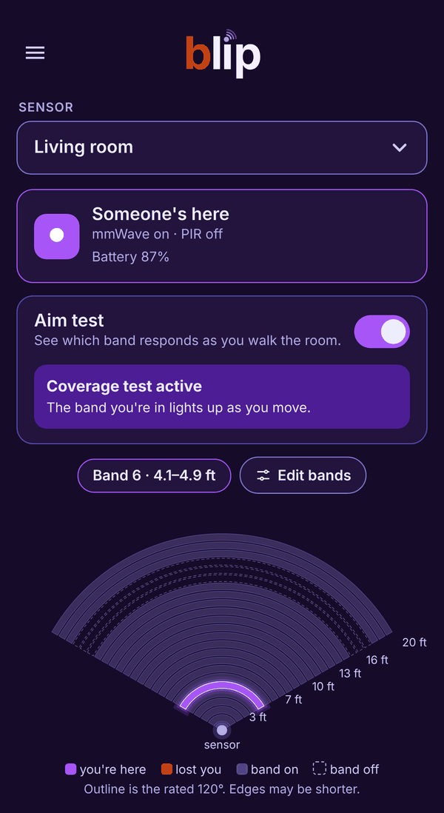
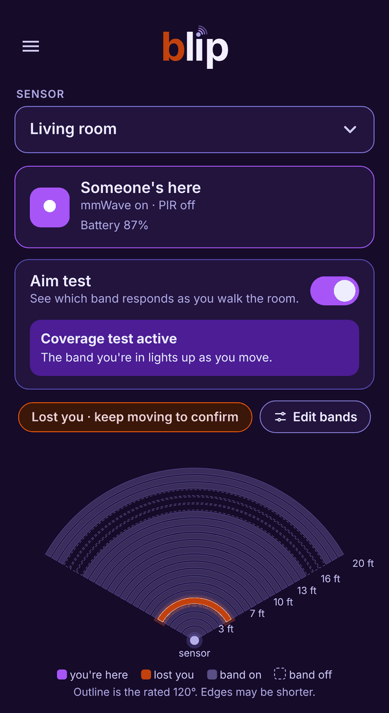
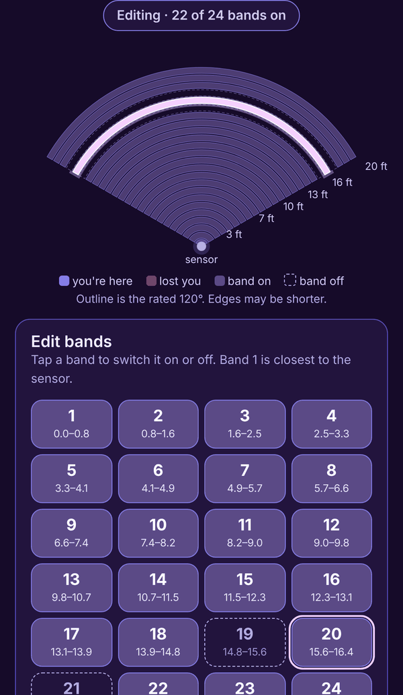

<p align="center"></p>

**Aim your presence sensors by walking the room.** Blip adds a page to your Home Assistant sidebar that shows a sensor's detection area live while you move, so you can place sensors that cover every room and barely overlap. It works in the Home Assistant phone app too.

<table>
  <tr>
    <td align="center"></td>
    <td align="center"></td>
    <td align="center"></td>
  </tr>
  <tr>
    <td align="center"><b>Aim test</b><br>The band you're in glows as you walk.</td>
    <td align="center"><b>Lost you</b><br>Orange when the sensor stops seeing you.</td>
    <td align="center"><b>Edit bands</b><br>Switch distance bands on or off.</td>
  </tr>
</table>

## 🙋 Help wanted

<p align="center"><a href="https://github.com/blip-ha/blip/blob/main/SENSORS.md#help-wanted"></a></p>

Blip only supports sensors someone has tested on real hardware. **Own one of these? You can add it.**

<!-- help-wanted:start -->
<!-- Generated from catalog/sensors.json. Don't edit by hand: run `npm run catalog` in frontend/. -->
| Sensor | What it takes | Sign up |
|---|---|---|
| Aqara FP1E | Profile file | **[🙋 I'll build this](https://github.com/blip-ha/blip/issues/new?template=sensor_claim.yml&title=Building%3A%20Aqara%20FP1E&sensor=Aqara%20FP1E%20%28Profile%20file%29&integration=Zigbee2MQTT&approach=Add%20a%20profile%20file.)** · [Who's on it?](https://github.com/blip-ha/blip/issues?q=is%3Aissue%20is%3Aopen%20label%3A%22in%20progress%22%20in%3Atitle%20%22Aqara%20FP1E%22) |
| Aqara FP310 | Profile file | **[🙋 I'll build this](https://github.com/blip-ha/blip/issues/new?template=sensor_claim.yml&title=Building%3A%20Aqara%20FP310&sensor=Aqara%20FP310%20%28Profile%20file%29&integration=Zigbee2MQTT&approach=Add%20a%20profile%20file.)** · [Who's on it?](https://github.com/blip-ha/blip/issues?q=is%3Aissue%20is%3Aopen%20label%3A%22in%20progress%22%20in%3Atitle%20%22Aqara%20FP310%22) |
| Aqara FP1 | Issue first: new Regions mode | **[🙋 I'll build this](https://github.com/blip-ha/blip/issues/new?template=sensor_claim.yml&title=Building%3A%20Aqara%20FP1&sensor=Aqara%20FP1%20%28Issue%20first%3A%20new%20Regions%20mode%29)** · [Who's on it?](https://github.com/blip-ha/blip/issues?q=is%3Aissue%20is%3Aopen%20label%3A%22in%20progress%22%20in%3Atitle%20%22Aqara%20FP1%22) |
| Aqara P1 motion sensor | Issue first: new Cone mode | **[🙋 I'll build this](https://github.com/blip-ha/blip/issues/new?template=sensor_claim.yml&title=Building%3A%20Aqara%20P1%20motion%20sensor&sensor=Aqara%20P1%20motion%20sensor%20%28Issue%20first%3A%20new%20Cone%20mode%29)** · [Who's on it?](https://github.com/blip-ha/blip/issues?q=is%3Aissue%20is%3Aopen%20label%3A%22in%20progress%22%20in%3Atitle%20%22Aqara%20P1%20motion%20sensor%22) |
| Aqara High Precision motion sensor (RTCGQ13LM) | Issue first: new Cone mode | **[🙋 I'll build this](https://github.com/blip-ha/blip/issues/new?template=sensor_claim.yml&title=Building%3A%20Aqara%20High%20Precision%20motion%20sensor%20%28RTCGQ13LM%29&sensor=Aqara%20High%20Precision%20motion%20sensor%20%28RTCGQ13LM%29%20%28Issue%20first%3A%20new%20Cone%20mode%29)** · [Who's on it?](https://github.com/blip-ha/blip/issues?q=is%3Aissue%20is%3Aopen%20label%3A%22in%20progress%22%20in%3Atitle%20%22Aqara%20High%20Precision%20motion%20sensor%20%28RTCGQ13LM%29%22) |
| Aqara P2 motion sensor | Issue first: new Cone mode, Thread/Matter | **[🙋 I'll build this](https://github.com/blip-ha/blip/issues/new?template=sensor_claim.yml&title=Building%3A%20Aqara%20P2%20motion%20sensor&sensor=Aqara%20P2%20motion%20sensor%20%28Issue%20first%3A%20new%20Cone%20mode%2C%20Thread%2FMatter%29)** · [Who's on it?](https://github.com/blip-ha/blip/issues?q=is%3Aissue%20is%3Aopen%20label%3A%22in%20progress%22%20in%3Atitle%20%22Aqara%20P2%20motion%20sensor%22) |
| Aqara FP400 | Issue first: new Map mode | **[🙋 I'll build this](https://github.com/blip-ha/blip/issues/new?template=sensor_claim.yml&title=Building%3A%20Aqara%20FP400&sensor=Aqara%20FP400%20%28Issue%20first%3A%20new%20Map%20mode%29)** · [Who's on it?](https://github.com/blip-ha/blip/issues?q=is%3Aissue%20is%3Aopen%20label%3A%22in%20progress%22%20in%3Atitle%20%22Aqara%20FP400%22) |
<!-- help-wanted:end -->

**Profile file** = one JSON file, no code. **Issue first** = open an issue with your approach and wait for a go-ahead.

1. **Claim it:** tap **🙋 I'll build this** on its row. The form opens filled in; tick the box and submit. (**Who's on it?** shows if someone already has it.)
2. **Build it:** follow [CONTRIBUTING.md](https://github.com/blip-ha/blip/blob/main/CONTRIBUTING.md) (a free GitHub account is all you need).
3. **Don't own one but want it?** [Request it](https://github.com/blip-ha/blip/issues/new?template=sensor_request.yml).

## Supported sensors

| Sensor | Mode | Status |
|---|---|---|
| Aqara FP300 (Zigbee2MQTT) | Band: 24 distance bands, each 0.25 m | ✅ Supported |

Blip is built for **Zigbee2MQTT**. [SENSORS.md](SENSORS.md) lists every sensor: supported, **help wanted** (approved and waiting for someone who owns one), and not eligible.

## What you can do

- **See the detection fan.** All 24 bands of the FP300's range, with switched-off bands shown dashed.
- **Aim test.** Turn it on, tap the sensor's button once to wake it, then walk. The band you're standing in lights up. If the sensor loses you, it turns orange.
- **Edit bands.** Switch individual bands on or off and save them to the sensor. Distances are shown in feet.
- **Status.** Presence (mmWave), PIR, and battery level.

## Install

Requires **Home Assistant 2025.1 or newer**. Pick the path that matches your Home Assistant version (**Settings → About** shows it).

| Your Home Assistant | How to install |
|---|---|
| 2026.11 or newer | [Marketplace](#marketplace-ha-202611-and-newer) (built in) |
| 2025.1 to 2026.10 | [HACS](#hacs-ha-20251-to-202610) |
| Any supported version | [Manual](#manual-any-version) |

### Marketplace (HA 2026.11 and newer)

1. Go to **Settings → Marketplace**.
2. Open the **⋮** menu (top right), then **Custom repositories**.
3. **GitHub link:** `https://github.com/blip-ha/blip` · **Type:** Integration · select **Add**. The first time, you're asked to connect GitHub. It only reads public information, and you never enter your GitHub password in Home Assistant.
4. Open **Blip** in the Marketplace and select **Install**.
5. Select **Restart Home Assistant** when asked.
6. Select **Set up** (or go to **Settings → Devices & services → Add integration** and search **Blip**), then **Submit**.

### HACS (HA 2025.1 to 2026.10)

[](https://my.home-assistant.io/redirect/hacs_repository/?owner=blip-ha&repository=blip&category=integration)

The button opens Blip in HACS on your own Home Assistant. Or add it by hand:

1. Open **HACS**.
2. Open the **⋮** menu (top right), then **Custom repositories**.
3. **Repository:** `https://github.com/blip-ha/blip` · **Type:** Integration · tap **Add**.
4. Search HACS for **Blip**, open it, and tap **Download**.
5. Restart Home Assistant.
6. Go to **Settings → Devices & services → Add integration**, search **Blip**, and tap **Submit**.

### Manual (any version)

1. Download the [latest release](https://github.com/blip-ha/blip/releases/latest) (**Source code (zip)** under Assets) and unzip it.
2. Copy the `custom_components/blip` folder into your Home Assistant `config/custom_components/` folder, so you end up with `config/custom_components/blip/manifest.json`. The Samba or File editor add-on works for this.
3. Restart Home Assistant.
4. Go to **Settings → Devices & services → Add integration**, search **Blip**, and tap **Submit**.

To update a manual install, replace the folder with the new version and restart.

**Blip** now appears in your sidebar, including in the Home Assistant phone app.

### Remove

Go to **Settings → Devices & services → Blip → ⋮ → Delete**. The sidebar page disappears right away. Then uninstall it from the Marketplace or HACS, or delete the `custom_components/blip` folder.

## Using the aim test

1. Open **Blip** and pick your sensor.
2. Turn on **Aim test**.
3. **Tap the sensor's button once** to wake it. Don't hold it: holding for about 5 seconds resets the sensor. The FP300 sleeps to save battery, so commands wait until it wakes.
4. Walk the room. The band you're in glows. If it turns **orange** ("lost you"), the sensor can't see you there: either that band is off, presence dropped, or the readings stopped.

While the test is on, Blip re-sends the tracking request every 10 minutes, right after the sensor confirms a band change you saved, and when you cancel a band edit. The FP300 reports distance only, not direction, and follows the nearest person.

## Development

Blip is a small Home Assistant integration (`custom_components/blip/`) plus a sidebar panel written in TypeScript and Lit (`frontend/`). Each supported sensor model is one JSON file in [`profiles/`](profiles/README.md).

```bash
cd frontend
npm install
npm run dev     # preview with a simulated FP300 (no Home Assistant needed)
npm test
```

**[docs/development.md](docs/development.md)** covers the rest: the code map, every command, testing on your own Home Assistant, adding a new mode, how changes land, and releasing. CI runs everything on each pull request and weekly, on Home Assistant 2025.1 and the latest. See [CHANGELOG.md](CHANGELOG.md) for what changed in each release.

## Contributing

Own a sensor from the **Help wanted** list? You can add it with one data file. See [CONTRIBUTING.md](CONTRIBUTING.md).

## Credits

Built with Claude; reviewed and tested on real hardware by the maintainer.

## License

[Apache 2.0](LICENSE)
